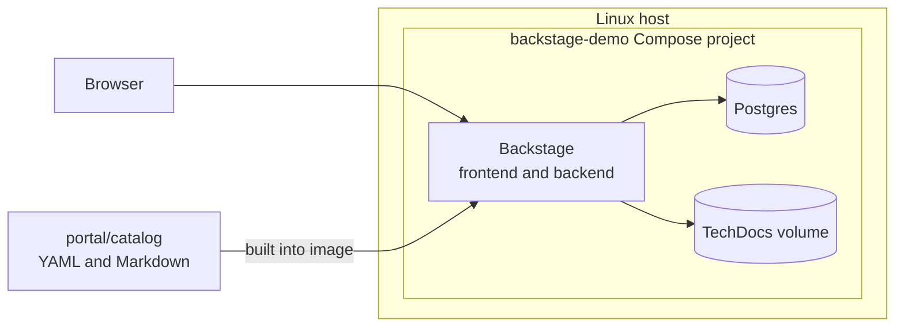

# Fossier Studio Portal

A [Backstage](https://backstage.io/) developer portal for the products I build
and run at [Fossier Studio](https://fossier.studio/projects/). It puts every
system, its components, its owner, and its docs in one place.


## What's in the catalog

| System | What it is | Where it runs |
|---|---|---|
| **Mycel** | GitHub Actions monitoring with on-device AI failure analysis | Mac, iOS, and Android apps, plus a Cloudflare Worker |
| **Bramble** | Community platform with real-time chat, voice, and video | Hetzner, with blue/green deploys behind nginx |
| **Canopy** | Staff scheduling for small counseling practices | Next.js and Expo, with Supabase on k3s |
| **MetaMatching** | Three-player experiment platform for a PhD dissertation | Node.js under hardened systemd |

Bramble has shipped 480 production deploys since March 2026, with a median of 6
minutes from push to live. The [engineering page](https://fossier.studio/engineering/)
covers how these systems are built and operated.

## What this project shows

- **Software catalog as code.** Systems, components, resources, owners, and
  dependencies are YAML in [`portal/catalog`](portal/catalog), reviewed like any
  other change.
- **Docs next to the catalog.** Each system has TechDocs, built by Backstage
  inside the container, with no separate docs pipeline.
- **A custom frontend.** The home page is a React page in Backstage's new
  frontend system that draws the system map from live catalog data. The theme
  matches the studio's site.
- **Repeatable deployment.** A multi-stage Dockerfile and Docker Compose stack
  run with memory and CPU limits, in their own network, next to other workloads.
- **CI on every change.** [GitHub Actions](.github/workflows/ci.yml) type-checks
  and builds the production image, and validates the Compose file.

| Catalog | System page | Docs |
|---|---|---|
|  |  |  |

## How it fits together



The portal shares a host with other workloads, including a k3s cluster. It runs
separately from that cluster, so a change here can't affect them. The reasons
behind this and other choices are in the [decision log](docs/decisions.md).

## Run it

Build the image from `portal/`:

```bash
docker build -t fossier-portal:latest portal
```

Copy `deploy/.env.example` to `deploy/.env`, then set a password and the host
address. Start the stack from `deploy/`:

```bash
docker compose up -d
```

## Security

- Guest sign-in is on, and the port is published to a private network only.
  Guest sign-in needs replacing before this goes on the internet.
- Secrets live in `deploy/.env`, which is gitignored.
- This public repo leaves out paths to private source repos.
- The portal is read-only: the tools for creating or importing software are
  turned off.

## What's next

1. Run the portal publicly at its own address, with HTTPS, real sign-in in place
   of guest access, and a privacy review of what the catalog exposes.
2. Live CI and Kubernetes status on each catalog page.
3. Self-service templates that create a new service with CI, docs, and a
   runbook.
4. GitOps deployment with Argo CD.
5. AWS infrastructure in Terraform.
