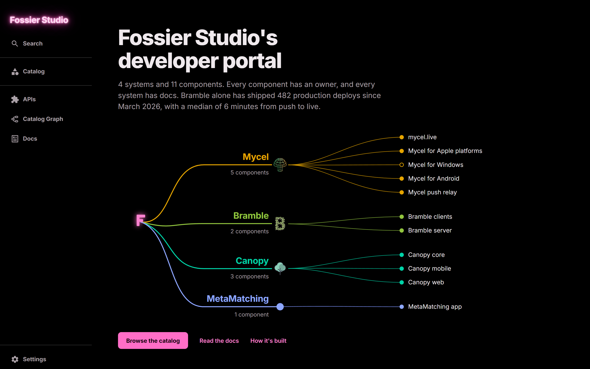
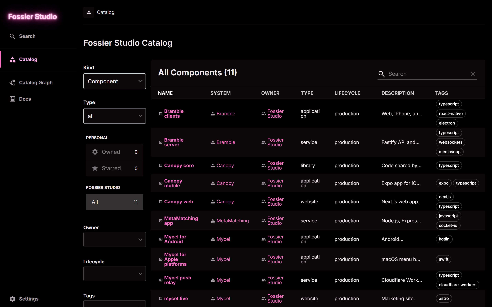
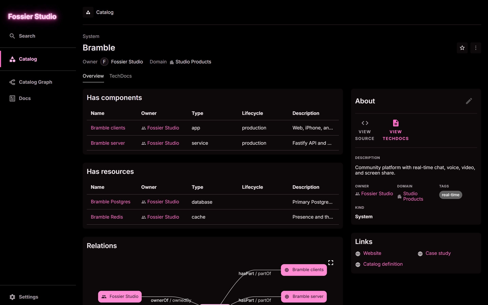
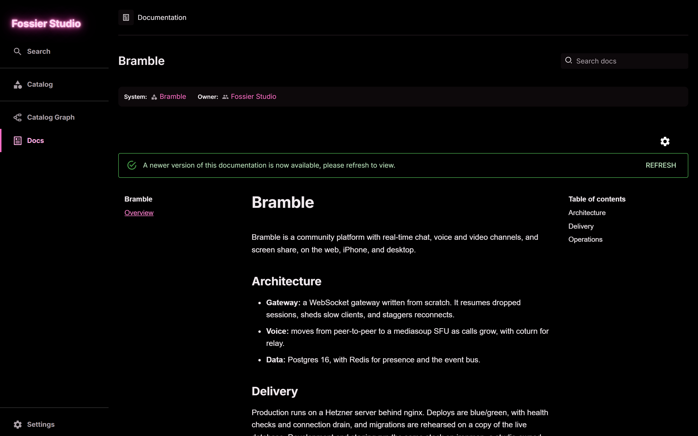
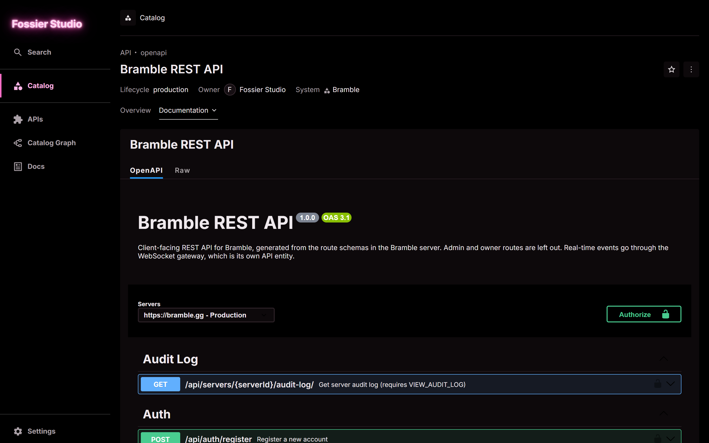
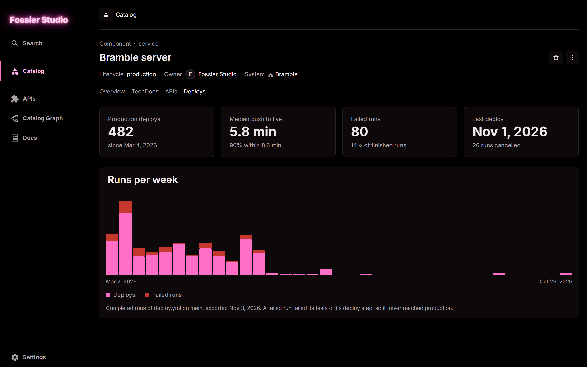
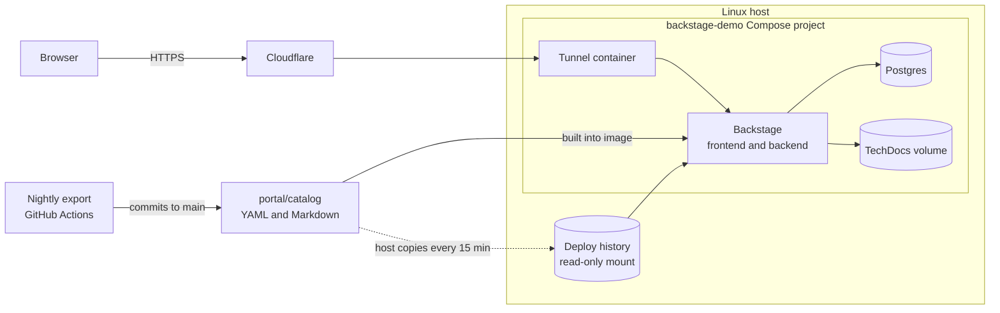

# Fossier Studio Portal

A [Backstage](https://backstage.io/) developer portal for the products I build
and run at [Fossier Studio](https://fossier.studio/projects/). It puts every
system, its components, its owner, and its docs in one place.

I built this solo over a weekend to bring my four products into one catalog and
to get hands-on with Backstage by running it for real.

**Live at [portal.fossier.studio](https://portal.fossier.studio/).** No sign-in
needed. It runs on a home server, so it may occasionally be offline.



## What's in the catalog

| System | What it is | Where it runs |
|---|---|---|
| **Mycel** | GitHub Actions monitoring with on-device AI failure analysis | Mac, iOS, and Android apps, plus a Cloudflare Worker |
| **Bramble** | Community platform with real-time chat, voice, and video | Hetzner, with blue/green deploys behind nginx |
| **Canopy** | Staff scheduling for small counseling practices | Next.js and Expo, with Supabase on k3s |
| **MetaMatching** | Three-player experiment platform for a PhD dissertation | Node.js under hardened systemd |

Bramble has shipped 482 production deploys since March 2026, with a median of
5.8 minutes from push to live, as counted by the portal's own
[deploys plugin](#a-custom-plugin). The [engineering page](https://fossier.studio/engineering/)
covers how these systems are built and operated.

## What this project shows

- **Software catalog as code.** Systems, components, resources, owners, and
  dependencies are YAML in [`portal/catalog`](portal/catalog), reviewed like any
  other change.
- **Docs next to the catalog.** Each system has TechDocs, built by Backstage
  inside the container, with no separate docs pipeline.
- **APIs in the catalog.** Bramble's REST API (OpenAPI, 152 operations) and its
  WebSocket gateway (AsyncAPI) are API entities, linked to the server that
  provides them and the clients that use them. The REST spec is generated from
  the server's own route schemas rather than written by hand.
- **A custom frontend.** The home page is a React page in Backstage's new
  frontend system that draws the system map from the catalog API, so it follows
  the catalog as entries change. The theme matches the studio's site.
- **A custom plugin.** A backend and frontend plugin pair, described below.
- **Repeatable deployment.** A multi-stage Dockerfile, a Docker Compose stack
  with memory and CPU limits, and a [deploy script](deploy/deploy.sh) that keeps
  the previous image for rollback.
- **CI on every change.** [GitHub Actions](.github/workflows/ci.yml) runs lint and
  tests, builds the production image, and validates the Compose file.

| Catalog | System page | Docs |
|---|---|---|
|  |  |  |

| API | Deploys |
|---|---|
|  |  |

## A custom plugin

[`deploys-backend`](portal/plugins/deploys-backend) and
[`deploys`](portal/plugins/deploys) show how often a service ships and how long
it takes. They were scaffolded with `backstage-cli new` and written for
Backstage's new backend and frontend systems.

- The **backend** serves `/api/deploys/history/:name`. It reads a run history
  exported from GitHub Actions, along with where those runs deploy to, by
  [`scripts/export-deploys.mjs`](scripts/export-deploys.mjs) and works out
  deploys, median and 90th percentile time from push to live, failed runs, and
  runs per week.
- The **frontend** adds a Deploys tab to any entity with a
  `fossier.studio/deploy-history` annotation, which Bramble's server and
  Canopy's web app have, and exports an API that the home
  page uses, so its deploy figures come from the data rather than being typed in.
- Both have tests: the summary math, the routes (including names that try to
  reach other files), sign-in being required, and the tab itself.

The portal has no route to the internet, so the history is exported instead of
fetched live. A [nightly workflow](.github/workflows/export-deploys.yml) exports
it and commits any new runs, and the host copies the files from `main` into a
read-only mount every 15 minutes, so new runs show up without a redeploy. The
[decision log](docs/decisions.md#build-the-deploys-plugin-on-exported-history)
covers why.

## How it fits together



The portal shares a host with other workloads, including a k3s cluster. It runs
separately from that cluster, so a change here can't affect them, and it reaches
the internet only through its own Cloudflare Tunnel. The reasons behind this and
other choices are in the [decision log](docs/decisions.md).

## Run it

Build the image from `portal/`:

```bash
docker build -t fossier-portal:latest portal
```

Create a Cloudflare Tunnel that points your hostname at `http://portal:7007`.
Copy `deploy/.env.example` to `deploy/.env`, then set the public URL, a password,
and the tunnel token. Start the stack from `deploy/`:

```bash
docker compose up -d
```

To update a running host, send the source and build the image there with:

```bash
deploy/deploy.sh <ssh-host>
```

This also installs a cron job on the host that keeps the deploy history current.
The nightly export needs two repository secrets, `BRAMBLE_ACTIONS_TOKEN` and
`CANOPY_ACTIONS_TOKEN`: fine-grained tokens with only Actions: read on each repo.

## Security

- **Open and read-only.** Visitors go straight in as guests. A
  [permission policy](portal/packages/backend/src/readOnlyPolicy.ts) denies every
  user action except reading, so the rule holds at the API as well as in the
  interface. The scaffolder and other plugins that act on outside systems aren't
  installed.
- **No way in except the tunnel.** The host publishes no ports for this stack,
  and its home network address stays hidden behind Cloudflare.
- **No way out.** The portal and Postgres sit on a private Docker network with no
  route to the host, its LAN, the k3s cluster, or the internet.
- Secrets live in `deploy/.env`, which is gitignored.
- This public repo leaves out paths to private source repos, and the portal shows
  nothing that isn't already in it.

## What's next

1. Live CI and Kubernetes status on each catalog page, replacing the exported
   deploy history.
2. Self-service templates that create a new service with CI, docs, and a
   runbook, with real sign-in for anyone who can use them.
3. GitOps deployment with Argo CD.
4. AWS infrastructure in Terraform.
